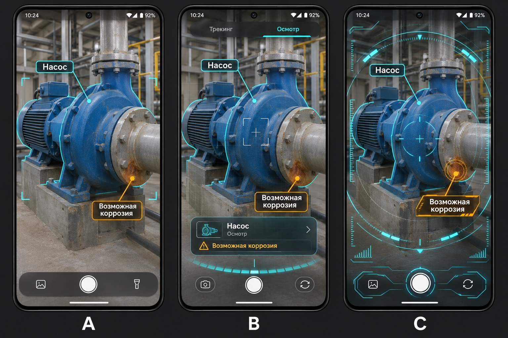

# Переписка о проекте

Сообщения пользователя и итоговые ответы Codex в хронологическом порядке. Локальные пути заменены ссылками внутри репозитория. Ссылка доступа к отдельному чату скрыта. Для актуальных требований см. [REQUIREMENTS.md](../REQUIREMENTS.md).

## Пользователь

[Ссылка на отдельный чат скрыта.]
Прочти этот чат и скажи если все там понял

## Codex

Пока не прочитал. По ссылке загрузился только заголовок «Посмотрите этот чат», а проверка в Chrome остановилась, потому что инструмент не смог подтвердить адрес открытой вкладки.

Пришли сюда текст переписки или скриншоты. Я коротко перескажу, что понял, и отмечу, если что-то останется неясным.

## Пользователь

Приложение к сообщению — [исходный технический план на семь дней](INITIAL_PLAN.md).

Тут текст сообщения картинки и описание. Так же в ковычках еще ответы и мои вопросы. Прочти и напиши что ты понял

"Так я сейчас все это перенесу в codex. Как лучше все это сделать?Я бы рекомендовал переносить всё в Codex как полноценный проект, а не просто копировать туда всю переписку из ChatGPT.

Главная задача — сделать так, чтобы Codex сразу понимал, что мы разрабатываем, какие решения уже приняли, что готово и что нужно делать дальше.

### Как лучше организовать перенос

1. Собрать контекст проекта. Описание идеи, цели, функциональность, архитектуру, технологии и уже принятые решения.
2. Перенести существующие файлы. Исходный код, конфигурации, структуру папок и необходимые документы.
3. Создать `AGENTS.md`. Это инструкции для Codex: правила разработки, ограничения, стиль кода, команды тестирования и то, что нельзя менять без необходимости.
4. Создать `PROJECT.md`. Общее описание проекта, его текущее состояние и основные технические решения.
5. Создать `TASKS.md`. Список выполненных, текущих и будущих задач с приоритетами.
6. Начать с проверки проекта. Пусть Codex сначала изучит файлы, поймёт архитектуру и предложит план, а не сразу переписывает код.

Так мы сохраним контекст и уменьшим риск того, что Codex начнёт принимать решения, которые противоречат уже согласованным.

### Готовый первый запрос для Codex

Скопируй его после переноса файлов:

Ты подключаешься к существующему проекту.

Сначала изучи всю структуру репозитория, исходный код и документацию.

Твои задачи:

1. Определи архитектуру и текущий стек технологий.
2. Прочитай AGENTS.md, PROJECT.md и TASKS.md.
3. Выясни, что уже реализовано, а что осталось сделать.
4. Найди технические проблемы и потенциальные риски.
5. Предложи пошаговый план дальнейшей разработки.

Правила:

- Не переписывай существующий работающий код без необходимости.
- Не удаляй файлы и функциональность без согласования.
- Сохраняй принятые архитектурные решения.
- Перед крупными изменениями объясняй план.
- После изменений запускай доступные тесты.
- Поддерживай документацию и список задач в актуальном состоянии.

На первом этапе ничего не изменяй. Представь анализ проекта и план следующих действий.

Codex действительно поддерживает проектные инструкции через `AGENTS.md`, а команда `/init` помогает создать этот файл.&#x20;

ChatGPT Learn+1

### Один важный вопрос

Ты хочешь перенести в Codex именно всю нашу переписку с решениями и планами или у тебя уже есть готовый код проекта?

От этого зависит способ переноса. Если переносим именно наши обсуждения, лучше сначала сформировать единый документ контекста, чтобы не потерять важные решения."

## Codex

Да, я понял идею и план. Ты хочешь получить **устанавливаемый APK для осмотра промышленного оборудования на Android**. Пользователь наводит камеру на агрегат, приложение распознаёт его тип, выделяет подозрительные участки и показывает карточку с возможными причинами, рекомендациями и тем, что стоит проверить вручную. Результат осмотра можно сохранить в историю. Распознавание и база знаний должны работать на телефоне без постоянного интернета.

- **Объём MVP на семь дней.** Цель — распознавать 4–5 классов оборудования и 2–3 вида видимых дефектов. Двигатели, насосы, компрессоры, вентили и трубопроводы приведены как кандидаты. Для дефектов перечислены коррозия, трещины, повреждения поверхности и заметные утечки. Ориентир по скорости — 5–10 анализируемых кадров в секунду на тестовом телефоне.
- **Как это будет устроено.** Kotlin и Compose для приложения, CameraX для обычного режима, ARCore для пространственного трекинга и AR-меток. Оба режима передают кадры в один движок через `FrameSource`. Для локальной детекции предложены YOLO и LiteRT, для обработки кадров — OpenCV, для каталога и истории — Room. Отдельно предложен поиск похожих случаев по локальной базе.
- **Как переносить работу в Codex.** Сначала разобраться, какие файлы и код уже есть. Затем зафиксировать правила разработки в `AGENTS.md`, описание и состояние проекта в `PROJECT.md`, а задачи и приоритеты в `TASKS.md`. Первый проход по проекту — анализ и план дальнейших действий без правок.

Из переписки пока неясно, **есть ли уже Android-проект, на каком смартфоне будем тестировать и какие классы, модели и данные возьмём для первого демо**. Распознавание отдельных узлов тоже упомянуто в общей цели, но в критериях готовности MVP его нет. Его место в первой версии ещё предстоит уточнить.

## Пользователь

Пока ничего нет, и я думал начать с первого пункта. И какой это пункт ты видишь? И все ли там правильно написано? И Идея была такой что смартфон еще его выделяет прямо в реальном времени и накладывает стрелки или описания или подсветки там где дефект или возможен дефект

## Codex

**Первый технический шаг — создать Android-проект с живой камерой и слоем для стрелок, подписей и подсветки.** В переписке есть два «первых пункта»: в плане переноса в Codex это «собрать контекст проекта», а в плане разработки — «День 1: запуск Android-приложения». Контекст у нас уже есть. Раз начинаем с нуля, я бы взял День 1 и добавил к нему проверку меток поверх видео.

Твою идею я понял так: ты наводишь смартфон на насос, приложение выделяет сам насос, а если замечает подозрительный участок, **сразу рисует стрелку именно к этому месту** и пишет, например, «Возможная коррозия». Пока участок виден, метка следует за ним по экрану. Когда он теряется из кадра, метка исчезает. Для этого сценария пользователю не нужно нажимать кнопку съёмки.

План в целом подходит, но я бы поправил три вещи:

- **Анализ видео и метки — основной сценарий MVP.** Камера показывает видео непрерывно, а модель обрабатывает свежие кадры в фоне. Ориентир 5–10 кадров в секунду относится к анализу, а отзывчивость стоит проверять по задержке появления метки. Координаты метки нужно пересчитывать с учётом поворота и обрезки кадра. [CameraX: анализ кадров](https://developer.android.com/media/camera/camerax/analyze) · [CameraX: преобразование координат](https://developer.android.com/media/camera/camerax/transform-output)
- **Модель должна находить место дефекта.** Классификатор целого кадра может сказать «похоже на коррозию», но для стрелки нужны координаты. Для первой версии достаточно детектора, который выдаёт рамку вокруг участка. Если нужна подсветка точно по форме трещины или пятна, понадобится сегментация. План на неделю зависит от того, есть ли подходящая модель или размеченные снимки выбранных дефектов. [Детекция объектов](https://developers.google.com/edge/mediapipe/solutions/vision/object_detector) · [Сегментация изображения](https://developers.google.com/edge/mediapipe/solutions/vision/image_segmenter)
- **Привязку к точке в пространстве стоит проверять отдельно.** CameraX позволяет рисовать метки по координатам в кадре. ARCore нужен, если стрелка должна оставаться привязанной к одной физической точке, пока ты меняешь ракурс. Для такой привязки ещё нужно определить, где на поверхности находится эта точка. [ARCore: якоря](https://developers.google.com/ar/develop/anchors) · [ARCore: определение точки в пространстве](https://developers.google.com/ar/develop/hit-test)

**Результат первого шага:** на смартфоне запускается приложение, показывает живое видео и рисует пробную стрелку с подписью по тестовым координатам. Проверяем, что метка попадает в нужное место при повороте телефона и обрезке кадра. Следующий шаг — получать эти координаты от модели, которая находит один реальный визуальный признак дефекта прямо в видеопотоке.

## Пользователь

Да все подходит. Модель будет обучать другие люди и потом добавим, пока надо разобраться с тем как в живом кадре расставить объект и при движении камеры не терять координаты. И больше использовать датчики и видео чтобы это работало. И еще хотелось бы интерфейс в виде jarvis из железного человека(фильм). Можешь даже заранее референсы показать и я скажу к чему стремимся

## Codex

На макете три варианта одного экрана осмотра. Во всех бирюзовая метка выделяет насос, а янтарная стрелка указывает на конкретный участок с подписью «Возможная коррозия».

- **A — минимум графики.** Почти весь экран занимает камера. Поверх видео видны контур оборудования, стрелка и подпись.
- **B — JARVIS для осмотра.** Бирюзовая дуга сканирования, прицел и полупрозрачная карточка. Графика заметна, а поверхность насоса хорошо видна.
- **C — как в шлеме Железного человека.** Крупные кольца, шкалы по краям и яркая подсветка подозрительного участка.

Для первого прототипа я бы **поставил метку касанием по реальной детали**, например по болту на корпусе неподвижного насоса. ARCore совмещает данные с камеры, гироскопа и акселерометра, чтобы определять положение телефона. По касанию приложение ищет точку на поверхности и создаёт в ней 3D-якорь. Когда ты двигаешь телефон, экранные координаты стрелки пересчитываются для каждого кадра, а её кончик остаётся у того же болта. [Трекинг ARCore](https://developers.google.com/ar/develop/fundamentals) · [Размещение меток на поверхности](https://developers.google.com/ar/develop/java/hit-test/developer-guide)

На телефоне проверим три движения: шаг вбок, приближение и смену ракурса. Отдельно проверим, как метка восстанавливается после краткой потери трекинга. Когда команда передаст модель, точку для размещения метки будет предлагать детектор.

Мне ближе **B** для основного экрана. Какой вариант ближе тебе — **A, B, C** или сочетание, например **B с кольцами из C**?

## Пользователь

Да тоже B нравится. Так тогда можем приступать к первой части. Только напиши еще инструменты которые мы используем

## Codex

Собрал первый Android-прототип в стиле **B** с бирюзовой дугой, полупрозрачной карточкой и янтарной стрелкой. По касанию приложение ищет точку на поверхности и ставит там одну ручную метку. Её экранные координаты пересчитываются при движении телефона. Позже точку для метки будет передавать модель распознавания.

Отладочный APK (`app/build/outputs/apk/debug/app-debug.apk` после сборки) · [Инструкция по запуску и проверке](../Readme.md)

**Инструменты, которые используем**

- **Kotlin и Jetpack Compose** — код приложения и интерфейс.
- **Google ARCore** — кадры камеры, трекинг по видео, гироскопу и акселерометру, поиск поверхности и 3D-якоря. [Как работает трекинг ARCore](https://developers.google.com/ar/develop/fundamentals)
- **OpenGL ES** — вывод живого изображения с камеры.
- **Android Studio, Android SDK 36 и Gradle Wrapper** — разработка и сборка. **ADB** — установка APK и чтение журналов.

Сборка и Android Lint прошли. Lint оставил два предупреждения о выборе SDK 36. На виртуальном Pixel 8a подтвердил установку APK и экран запроса доступа к камере. ARCore не смог запустить сессию из-за того, как эмулятор выдаёт заднюю камеру.

**Следующая проверка на смартфоне с ARCore:** поставить метку на конкретный болт, сделать шаг вбок и приблизиться. Кончик стрелки должен остаться на том же болте.

## Пользователь

То есть я могу сейчас на андроиде проверить что вышло?

## Codex

Да. Скопируй APK на Android и открой его (`app/build/outputs/apk/debug/app-debug.apk` после сборки). Телефон должен поддерживать [ARCore](https://developers.google.com/ar/devices). При запуске разреши доступ к камере. Если приложение попросит установить или обновить Google Play Services для AR, сделай это.

Наведи камеру на неподвижную деталь, например болт, и коснись его на экране. Затем сделай шаг вбок и приблизься. **Кончик янтарной стрелки должен остаться на том же болте.**

На эмуляторе я подтвердил установку и запуск APK. Удержание метки предстоит проверить на реальном телефоне.

## Пользователь

Надо весь проект перекинуть в эту папку по пути `KST Hakaton`. Добавь наш чат в виде MD файла для будущих агентных ии. И напиши заранее нужные requirements. Так же запушь его в репозиторий в это папке в main ветку.
