# Сущности базы AR Engineering

Основная база на ноутбуке использует SQLite. Ниже перечислены все её прикладные таблицы схемы версии 2. `1 → N` означает «одна запись связана с несколькими», а «необязательная связь» допускает пустой внешний ключ. [SQL-схема](../server/schema.sql) · [Запуск и API](../server/README.md).

## Серверная SQLite

| Таблица | Что хранит | Ключ и связи |
| --- | --- | --- |
| `users` | Почта, хеш пароля, имя, роль и активность учётной записи | `id`; почта уникальна. Один пользователь может иметь несколько сессий, отчётов, выполненных работ и загруженных поверок. |
| `sessions` | Хеш токена и время истечения | `token_hash`; `user_id → users.id`. |
| `equipment` | Карточка агрегата или узла, инвентарный номер, модель, серийный номер, описание и характеристики | `id`; необязательный `parent_id → equipment.id` образует дерево узлов. |
| `equipment_identifiers` | Значения QR-кода и шильдика для поиска экземпляра | `(kind, value)`; `equipment_id → equipment.id`. |
| `equipment_lines` | Название и описание технологической линии | `id`; состав хранится в `line_equipment`. |
| `line_equipment` | Позиция оборудования по ходу линии | `(line_id, position)`; `line_id → equipment_lines.id`, `equipment_id → equipment.id`. |
| `documents` | Файлы паспортов, руководств, режимных карт, протоколов и регламентов | `id`; `equipment_id → equipment.id`. Испытание или поверка может ссылаться на файл. |
| `operating_modes` | Структурированные режимы работы, параметры и источник данных | `id`; `equipment_id → equipment.id`. |
| `sensors` | Код показателя, единица, номинал, уставки предупреждения и тревоги | `(equipment_id, code)`; `equipment_id → equipment.id`, необязательный `component_id → equipment.id`. |
| `telemetry_samples` | Замеры оборотов, вибрации и температуры с исходными временем и диагнозами | `id`; `equipment_id → equipment.id`. У каждого агрегата своя история. |
| `current_telemetry` | Указатель на текущий замер и время обновления | `equipment_id` одновременно ключ таблицы и ссылка на `equipment.id`; `(equipment_id, sample_id) → telemetry_samples.(equipment_id,id)`. |
| `operating_state` | Состояние «работает / остановлен / неизвестно», моточасы и источник | `equipment_id` одновременно ключ таблицы и ссылка на `equipment.id`. |
| `defect_types` | Справочник визуальных признаков дефектов | `id`; на запись может ссылаться шаг осмотра. |
| `inspection_checks` | Порядок шагов, инструкция, критерий осмотра и рекомендация | `id`; `equipment_id → equipment.id`, необязательные `component_id → equipment.id` и `defect_type_id → defect_types.id`. |
| `maintenance_plans` | Регламент ТО или поверки, интервал, следующий срок и окно предупреждения | `id`; `equipment_id → equipment.id`, для плана поверки возможна ссылка `(equipment_id, sensor_code) → sensors.(equipment_id,code)`. |
| `maintenance_events` | Факты ТО, замены или ремонта с датой, моточасами и заметками | `id`; оборудование обязательно. План и исполнитель необязательны, исполнитель связан с `users`. |
| `equipment_tests` | Результаты испытаний и поверок, дата, срок действия, номер свидетельства, комментарий | `id`; оборудование обязательно. Возможны ссылки на датчик, протокол в `documents` и загрузившего пользователя. API загрузки поверки требует датчик. |
| `reports` | Автор, время, заметки и снимки карточки, замера и уставок при сохранении | `id`; `equipment_id → equipment.id`, `author_id → users.id`. Снимки хранятся как JSON. |
| `report_items` | Результат, наблюдение и снимок инструкции по каждому шагу отчёта | `(report_id, check_id)`; составные внешние ключи связывают отчёт и шаг с тем же оборудованием. |
| `report_attachments` | Файлы с именем и MIME-типом. Через API загружаются фотографии. | `id`; `report_id → reports.id`, необязательный `(report_id, check_id) → report_items.(report_id,check_id)`. PDF/Excel сейчас формируются по запросу. |

## Связи серверной базы

```mermaid
erDiagram
    users ||--o{ sessions : "входит"
    users ||--o{ reports : "создаёт"
    users o|--o{ maintenance_events : "выполняет"
    users o|--o{ equipment_tests : "загружает"
    equipment o|--o{ equipment : "содержит узлы"
    equipment ||--o{ equipment_identifiers : "распознаётся по"
    equipment_lines ||--o{ line_equipment : "содержит позиции"
    equipment ||--o{ line_equipment : "входит в линию"
    equipment ||--o{ documents : "имеет файлы"
    equipment ||--o{ operating_modes : "имеет режимы"
    equipment ||--o{ sensors : "имеет датчики"
    equipment o|--o{ sensors : "узел измерения"
    equipment ||--o{ telemetry_samples : "имеет историю"
    equipment ||--o| current_telemetry : "имеет текущий замер"
    telemetry_samples ||--o| current_telemetry : "выбранный замер"
    equipment ||--o| operating_state : "имеет состояние"
    equipment ||--o{ inspection_checks : "осматривается по"
    equipment o|--o{ inspection_checks : "узел осмотра"
    defect_types o|--o{ inspection_checks : "признак в шаге"
    equipment ||--o{ maintenance_plans : "план обслуживания"
    sensors o|--o{ maintenance_plans : "график поверки"
    equipment ||--o{ maintenance_events : "работы"
    maintenance_plans o|--o{ maintenance_events : "выполнение плана"
    equipment ||--o{ equipment_tests : "история испытаний"
    sensors o|--o{ equipment_tests : "история поверок"
    documents o|--o{ equipment_tests : "протокол"
    equipment ||--o{ reports : "отчёты осмотра"
    reports ||--o{ report_items : "результаты шагов"
    inspection_checks ||--o{ report_items : "шаг осмотра"
    reports ||--o{ report_attachments : "приложенные файлы"
    report_items o|--o{ report_attachments : "фото шага"
```

У серверного отчёта есть внешняя связь с оборудованием и автором. Данные замера и уставки копируются в отчёт на момент сохранения, поэтому их можно прочитать после смены текущего замера. Карточка цифрового двойника собирается из оборудования и его связанных таблиц.

## Локальная Room на Android

Эта отдельная база работает на телефоне и воспроизводит те же исходные замеры. [Модель Room](../app/src/main/java/com/arengineering/inspection/data/TelemetryDatabase.kt).

| Таблица | Что хранит | Ключ и связи |
| --- | --- | --- |
| `vibration_readings` | Обороты, СКЗ, амплитуды 1× и 2×, ВЧ шум и исходный диагноз | `(equipment_id, measured_at)`. |
| `temperature_readings` | Обороты, температура подшипника и обмоток, исходный диагноз | `(equipment_id, measured_at)`. |
| `current_equipment_samples` | Время текущей исходной записи и время обновления на телефоне | `equipment_id`; запрос Room соединяет обе таблицы замеров по `(equipment_id, measured_at)`. Локальные связи используются в запросе. |
