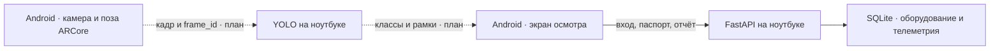

# Интеграция Android, серверных данных и YOLO

Android-приложение и сервер с данными находятся в этом репозитории. Приложение получает паспорт и сценарий осмотра по HTTP. YOLO планируем запускать на том же ноутбуке и вызывать отдельным запросом с кадром камеры. После установки зависимостей и загрузки весов стенд может работать в одной локальной сети без интернета.



## Запуск и проверка backend

1. Запустите [сервер FastAPI и создайте учётную запись](../server/README.md#запуск). На телефоне указывайте IPv4 ноутбука, например `http://192.168.1.10:8000`. Оба устройства должны быть в одной сети. Для теста с HTTP используйте отладочный APK и демонстрационную учётную запись.
2. В текущем APK нажмите «?» и выполните `server http://192.168.1.10:8000`, затем `login engineer@example.com` с почтой созданной записи. Пароль вводится отдельным шагом. Успешная проверка соединения возвращает `HTTP 200` и `{"status":"ok"}`.
3. `pasport 1` показывает полный ответ сервера, `watch 1` обновляет его, `checks 1` выводит узлы и шаги. Можно записать результат через `savecheck 1 1 no_visible_issue` и открыть отчёт командой `report <ID>`. Команду записи используйте на демонстрационной базе после ручного осмотра.

Реализация запросов есть в [TerminalServer.kt](../app/src/main/java/com/arengineering/inspection/TerminalServer.kt). Терминал показывает JSON для отладки. Для экранов Compose удобно вызывать тот же API из репозитория данных и хранить состояние экрана во ViewModel. Описание запросов в JSON доступно на ноутбуке по `/openapi.json`.

## Контракт для UI

### Вход и выбор оборудования

1. `POST /auth/login` принимает JSON `{"email":"…","password":"…"}`. Из ответа возьмите `access_token` и передавайте заголовок `Authorization: Bearer <access_token>` в запросах к данным. `GET /auth/me` возвращает профиль и роль, `POST /auth/logout` закрывает сессию. При `401` предложите войти повторно.
2. После чтения идентификатора вызовите `GET /equipment/resolve?kind=qr&value=DEMO-PUMP-001`. Для шильдика используется `kind=nameplate`. Ответ на демонстрационный QR — `{"equipment_id":1}`. Для отладки экранов можно сразу выбрать насос `1`. При `404` оставьте возможность считать идентификатор повторно.
3. `GET /equipment/1/passport` возвращает данные для главного экрана, правой панели и карточек осмотра.

### Какие поля показать

- `equipment` содержит `id`, `name`, `asset_tag`, `model`, `serial_number`, `description` и `specifications`. Значения `model` и `serial_number` у демонстрационного насоса могут быть `null`.
- `lines[].equipment` содержит состав линии по `position` в направлении потока, а `components` — узлы выбранного оборудования. У каждого узла свой `id`.
- `telemetry` содержит текущий замер. `measured_at` показывает время исходной записи, `updated_at` — когда сервер выдал её в цикле, `source: "replay"` обозначает демонстрационное воспроизведение. Обновлять паспорт для экрана можно примерно раз в секунду, пока экран открыт. Последний полученный замер можно оставить на экране с отметкой об обрыве связи.
- `sensors[]` содержит `label`, `reading`, `unit`, `nominal_value`, `warning_above`, `alarm_above` и рассчитанный `status`. Используйте `warning` и `alarm` для уведомлений в правой панели. `unknown` означает, что нет показания или уставки. `vibration_diagnosis` и `temperature_diagnosis` внутри `telemetry` — подписи из исходных записей.
- `maintenance[]` содержит `status`, `message`, `remaining_hours` и `remaining_days`. Для `due_soon` и `due` можно показать сообщение прямо из ответа. Для насоса №1 демонстрационное предупреждение — «Приближается плановое ТО», осталось 50 моточасов.
- `operating_modes`, `tests`, `maintenance_history` и `documents` заполняют карточку цифрового двойника. Скачать документ можно через `GET /documents/{id}` с тем же токеном. Пустые списки и отсутствующие замеры допустимы, например у демонстрационной задвижки.
- `checks[]` уже отсортирован по `position`. Для текущего шага покажите `title`, `instructions`, `acceptance_criteria` и `recommendation`. Связь с конкретным узлом идёт через `component_id → components[].id`. Если `component_id` пустой, проверка относится к агрегату в целом. Для насоса №1 есть шаги осмотра зоны вала и кожуха муфты. Сигнал датчика и визуальный результат храните отдельно в состоянии экрана.

### Сохранение осмотра

При нажатии «Начать осмотр» запомните `telemetry.id`, если замер есть. Сохраните в черновике результат каждого шага. На «Отправить отчёт» вызовите `POST /reports`. В примере ниже одна завершённая проверка с демонстрационными ID.

```json
{
  "equipment_id": 1,
  "telemetry_sample_id": 1,
  "notes": "Осмотр корпуса",
  "items": [
    {
      "check_id": 1,
      "outcome": "no_visible_issue",
      "observation": "Видимой влаги нет"
    }
  ]
}
```

В рабочем запросе берите `check_id` и `telemetry_sample_id` из паспорта. Сервер проверяет связь с оборудованием и принимает каждый шаг один раз в отчёте. Допустимые результаты — `no_visible_issue`, `needs_check`, `possible_defect`, `confirmed_defect`, `inconclusive`, `skipped`. При пропуске `telemetry_sample_id` сервер использует текущий замер на момент сохранения.

Ответ `201` содержит `{"id": …}`. Откройте сохранённый отчёт через `GET /reports/{id}` или список через `GET /equipment/{id}/reports`. При `422` покажите `detail` и сохраните черновик. Дождитесь ответа на отправку перед повторным нажатием.

После сохранения UI может загрузить фото и скачать PDF/Excel. Для карточки датчика доступна история поверок и скачивание протоколов. Мастер и администратор могут загружать новые поверки. Форматы запросов описаны в [документации сервера](../server/README.md#поверки-датчиков).

## Контракт для разработчика YOLO

Ниже предлагаемая договорённость для первого подключения. Обработчика кадров в текущем FastAPI ещё нет. Код модели можно вести отдельно и подключить к серверу после проверки согласованного формата.

### Что передать интегратору

- Файл весов и его версия, список классов с устойчивыми именами, команда запуска, зависимости для ноутбука.
- Размер входа, цветовой порядок, правила изменения размера и добавления полей, пороги уверенности и способ вернуть координаты в пиксели кадра.
- Небольшой набор проверочных кадров с ожидаемыми классами и рамками. По ним можно сверить преобразование координат до прогона с живой камерой.

### Предлагаемый запрос и ответ

Предложение для демо — `POST /vision/detect?frame_id=42` на том же локальном сервере. В теле — байты одного JPEG, заголовки `Content-Type: image/jpeg` и `Authorization: Bearer <access_token>`. Android присваивает кадру `frame_id`, сервер возвращает его без изменений. В примере ниже модель обнаружила защитный кожух муфты с классом `coupling_guard`.

```json
{
  "frame_id": 42,
  "image_width": 1280,
  "image_height": 720,
  "model_version": "demo-v1",
  "detections": [
    {
      "class_name": "coupling_guard",
      "confidence": 0.91,
      "bbox_xyxy": [420, 210, 815, 540]
    }
  ]
}
```

Координаты `[x_min, y_min, x_max, y_max]` указаны в пикселях полученного JPEG, начало в левом верхнем углу. Если вход модели масштабировали или добавляли поля, модельный обработчик применяет обратное преобразование перед ответом. При успешной обработке без детекций возвращайте `detections: []`. Сетевую ошибку или невозможность обработать кадр передавайте отдельным HTTP-статусом.

### Как состыковать модель с паспортом и AR

1. **Выбор экземпляра.** UI получает `equipment_id` по QR, шильдику либо ручному выбору. Класс `pump` может подтвердить, что насос виден в кадре. Для сопоставления шага и детекции команда согласует отображение `class_name → нужный шаг/узел`. Например, класс `coupling_guard` используется в шаге «Защитный кожух муфты», если такой класс обучен. Храните имена классов отдельно от числовых ID БД.
2. **Получение кадра.** Точка подключения — [ArPreview.onDrawFrame](../app/src/main/java/com/arengineering/inspection/ArPreview.kt#L123), где уже есть текущий `Frame` ARCore. Заберите и освободите CPU-изображение через `acquireCameraImage()` и `Image.close()`. Сжатие, сеть и инференс работают вне потока отрисовки. Для начала держите один запрос в полёте и берите свежий кадр после ответа, чтобы задержка не росла из-за очереди. [Документация ARCore Frame](https://developers.google.com/ar/reference/java/com/google/ar/core/Frame).
3. **Рамка на экране.** Сохраните для отправленного кадра `frame_id`, время и преобразование из пикселей камеры в координаты превью через `transformCoordinates2d(IMAGE_PIXELS, …, VIEW, …)`, пока этот `Frame` текущий. Если JPEG до отправки поворачивали или обрезали, учтите это при обратном преобразовании. Отбрасывайте результаты старого шага, устаревшего кадра или кадра до смены ориентации. При движении камеры скрывайте рамку, когда она уже не совпадает с текущим видом. [Преобразования координат ARCore](https://developers.google.com/ar/reference/java/com/google/ar/core/Frame#transformCoordinates2d(com.google.ar.core.Coordinates2d,%20float[],%20com.google.ar.core.Coordinates2d,%20float[])).
4. **Результат узла.** Для первой версии показывайте 2D-рамку и подсказку рядом с текущим шагом. Детекция детали подтверждает, что она видна. Детекция дефекта может предложить `possible_defect`; результат выбирает инженер. Пустой список детекций оставляет результат открытым, например `inconclusive`, если нужный участок не удалось рассмотреть.
5. **Удержание при движении.** Для 3D-метки понадобится подходящая поверхность или валидная глубина. [Текущий прототип](../app/src/main/java/com/arengineering/inspection/ArPreview.kt#L200) ставит ручную метку через `hitTest` и `createAnchor`. Автоматическую постановку лучше проверять отдельным этапом после 2D-рамок. Координаты из запоздавшего ответа нельзя подставлять в `hitTest` другого ракурса без перепривязки. При потере трекинга скрывайте метку.

## Совместная проверка

1. **UI и backend.** Войти, открыть насос №1, увидеть изменяющиеся значения и сообщение о ТО, пройти шаги вручную, сохранить отчёт и открыть его. Повторить с выключенным сервером, чтобы проверить обработку обрыва связи.
2. **YOLO и Android.** Сначала согласовать один класс узла и сверить координаты на тестовом кадре. Затем показать узел в живом кадре на телефоне, проверить рамку при повороте и приближении, задержку ответа и поведение при пустом результате.
3. **Весь сценарий.** Считать QR, открыть паспорт, запустить осмотр, подсветить найденный узел, подтвердить результат вручную и открыть отчёт с тем же замером, который пришёл в начале осмотра.
