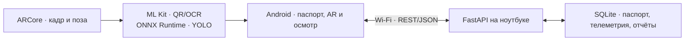

# AR Engineering · общий проект

Прототип «Кибер 102» помогает инженеру идентифицировать промышленное оборудование, сверить показания с уставками, осмотреть узлы через камеру и сохранить результаты. Первый сценарий использует демонстрационный центробежный насос №1.

## Три части

- **UI.** Kotlin, Jetpack Compose, HUD варианта B. В серверном режиме есть вход, чтение кода, ручной выбор, паспорт, предупреждения, шаги и история. Автономный деморежим показывает тот же интерфейс с примером сценария. [Контракт UI](UI_API.md)
- **CV.** ARCore даёт кадр и позу. ML Kit читает QR и восьмизначный номер по нескольким кадрам. ONNX Runtime на телефоне запускает YOLO11n для насоса, ориентиров и коррозии. Веса базовые, `pump-cv-1`. Запрос распознавания выполняется вне потока отрисовки. 2D-метки используют геометрию кадра, скрываются при потере трекинга и ограничены возрастом результата и движением камеры. [Пакет CV](../cv/README_START_HERE.txt) · [Ограничения моделей](../cv/android-baseline/MODEL_CARD.txt)
- **Backend.** FastAPI и SQLite на ноутбуке. По QR или номеру сервер возвращает карточку оборудования с узлами, уставками и историей. Телеметрия насоса воспроизводит 500 пар записанных замеров. API сохраняет отчёты, фото, протоколы поверок и экспортирует PDF/XLSX. [Запуск сервера](../server/README.md) · [Схема данных](DATABASE.md)

Видеокадры остаются на телефоне. SQLite хранится на ноутбуке. После подготовки модели и ПО внешнее подключение к интернету для сценария не требуется.

## Прогон

1. Запустите сервер и создайте учётную запись. Установите отладочный APK и введите адрес ноутбука и данные для входа.
2. Покажите камере [демонстрационный QR](../cv/equipment-identification/examples/QR_00123456.png) или напечатанный номер `00123456`. Доступен ручной выбор. Сервер ищет по строке и сохраняет ведущие нули. Прежний QR `DEMO-PUMP-001` сохранён в API, но текущий мобильный декодер ожидает восемь цифр.
3. Откройте паспорт, начните проверку и подтвердите выбранный насос. При удачном кадре CV покажет рамку и ориентир рамы. Доступен ручной переход.
4. Пройдите осмотр зоны вала и кожуха вручную. На шаге коррозии наведите камеру на раму. При наличии кандидата интерфейс показывает уверенность и, когда геометрия позволяет, рамку. Результат выбирает инженер. В отчёт сохраняются результат, замер, заметка и наблюдение CV, если при ручном подтверждении был кандидат.
5. Откройте отчёт в истории. Фото, PDF/XLSX и поверки на этом этапе доступны через серверный API.

## Сверка с ТЗ

| Пункт ТЗ | Реализовано в прототипе | Что требуется для завершения |
| --- | --- | --- |
| 4.1 Идентификация | QR и OCR восьми цифр, ручной выбор, поиск цифровой карточки | Проверить чтение с реального оборудования. Загрузить фактические идентификаторы. Расширить OCR на форматы заводских шильдиков. Внешний вид определяет тип насоса. |
| 4.2 ИИ-анализ | Обнаружение насоса, ориентир рамы, экспериментальный признак коррозии, уверенность, ручные статусы и рекомендации | Подтвердить качество на целевом насосе. Связать отклонения датчиков и CV с выбором узлов и шагов. Течь, кожух, масло и другие признаки требуют отдельных моделей или ручной проверки. |
| 4.3 Эксплуатационный ресурс | Демонстрационный остаток до планового ТО по моточасам | Загрузить нормы компонентов, даты установки и замен. Добавить фактический учёт наработки и расчёт остаточного ресурса. Показать раздельно норму, оценку ресурса и фактический визуальный результат. |
| 4.4 AR | Ручной пространственный якорь, короткоживущие 2D-рамки модели, подсказки и карточки узлов | Проверить рамки на физическом телефоне. Добавить выбор узла по метке и устойчивое сопровождение при движении. Заказчик допускает 2D-метки и рамки, поэтому заявлять 3D-реконструкцию для демо не требуется. |
| 4.5 Цифровой двойник | Демонстрационный паспорт, состав линии, уставки, история осмотров и серверные сущности ТО и поверок | Наполнить паспорт реальными данными. Вывести в UI режимные карты, документы, протоколы и историю обслуживания. |
| 4.6 Результаты | Ручной осмотр с замечаниями и записью отчёта в историю | Добавить регистрацию ТО и замены из приложения. Подключить фото к шагам, выгрузку и работу с поверками в UI. |

Приоритет к защите — прогнать насос на целевом телефоне и реальной поверхности, проверить QR, рамки в двух ориентациях, движение камеры и отчёт по локальному Wi-Fi. Затем наполнить цифровой двойник одного агрегата и добавить расчёт ресурса компонентов, если для них есть подтверждённые исходные данные. Ветки с исходными работами и [исследовательские результаты CV](../cv/current-cv-status/TEAM_STATUS.txt) сохраняются для отдельной проверки.

## Что проверено после объединения

- Android APK собирается, Lint проходит, все 48 тестов CV проходят, включая три прогона ONNX по контрольным кадрам. В APK проверены три исходных ONNX-файла и библиотеки ARM64.
- На свежей базе и копии базы предыдущей версии проверены миграция, поиск насоса по восьмизначному QR и номеру, сохранение предыдущего отчёта и запись наблюдения в новый отчёт.
- Связка UI и backend ранее прошла ручной осмотр в эмуляторе. Подключённый CV на живой камере физического телефона ещё предстоит проверить. Частота кадров, задержка и точность разметки на производственном оборудовании пока не измерены.
